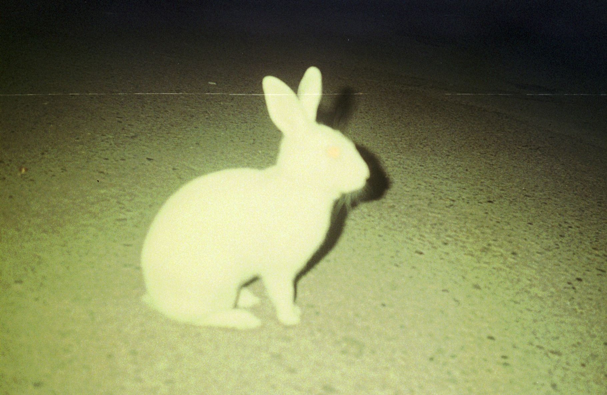

# 🎨 Pixel Playground — A Command-Line Image Editor

A lightweight Python image editor built from scratch using **NumPy**, **Pillow**, and **convolution**. Edit photos from the terminal with flags like `--brightness`, `--red`, `--blur`, `--contrast`, and more.


---

## 📖 Overview

This project is a **from-scratch implementation of core image-processing operations** — no OpenCV, no deep learning, just raw NumPy math.

Every edit boils down to one idea: **an image is a 3D array of numbers**, and editing it is arithmetic on those numbers.

### What you can do

- **Brighten / darken** — add or subtract from every pixel
- **Adjust color channels** — boost R, G, or B independently
- **Blur** — box blur or Gaussian blur using convolution
- **Sharpen** — edge-enhancing convolution kernel
- **Detect edges** — gradient-based (Sobel-like) edge detection
- **Convert to grayscale** — luminance-weighted conversion
- **Chain any combination** into one command

---

## 🏗️ How It Works

```
┌─────────────────┐
│   Input Image   │
└────────┬────────┘
         │  (Pillow loads as NumPy array)
         ▼
┌────────────────────────────────────────────────┐
│  apply_edits() — Operations applied in order: │
│                                                │
│   1. Blur        (convolution)                 │
│   2. Sharpen     (convolution)                 │
│   3. Brightness  (additive)                    │
│   4. Contrast    (multiplicative)              │
│   5. Channels    (R, G, B adjustments)         │
│   6. Saturation  (color-space math)            │
│   7. Grayscale   (luminance weights)           │
│   8. Edges       (gradient magnitude)          │
│   9. Invert      (255 - value)                 │
└────────┬───────────────────────────────────────┘
         │
         ▼
┌─────────────────┐
│  Output Image   │
└─────────────────┘
```

---

## 📁 Project Structure

```
image-playground/
├── images/                 # Source images (input)
├── output/                 # Edited images (generated)
├── scripts/
│   ├── explore.py          # Inspect an image as a NumPy array
│   ├── edit.py             # Main CLI tool with all effects
│   ├── redder.py           # Standalone channel-adjustment demo
│   ├── edges.py            # Standalone edge detection demo
│   └── blur.py             # Standalone blur/convolution demo
├── requirements.txt
├── .gitignore
└── README.md
```

---

## 🛠️ Tech Stack

| Tool         | Purpose                              |
| ------------ | ------------------------------------ |
| Python 3.12  | Language                             |
| NumPy        | Array math — every operation is a NumPy expression |
| Pillow (PIL) | Load and save image files            |
| argparse     | Command-line interface               |
| Matplotlib   | Side-by-side comparison (optional)   |

---

## 🚀 Quick Start

```bash
# 1. Clone
git clone https://github.com/YOUR_USERNAME/image-playground.git
cd image-playground

# 2. Virtual environment
python -m venv .venv
.venv\Scripts\activate            # Windows
source .venv/bin/activate         # Mac/Linux

# 3. Install dependencies
pip install -r requirements.txt

# 4. Add a photo
#    Place any JPG or PNG into the images/ folder.

# 5. Try it out
python scripts/edit.py images/photo.jpg --brightness 40
```

---

## 🎨 Usage Examples

```bash
# Brighten
python scripts/edit.py images/photo.jpg --brightness 40

# Warm sunset look
python scripts/edit.py images/photo.jpg --red 40 --blue -30 --brightness 10

# Dreamy portrait (blur + brighten)
python scripts/edit.py images/photo.jpg --blur 5 --brightness 20

# Cinematic punch (high contrast, vivid, slightly dark)
python scripts/edit.py images/photo.jpg --contrast 1.5 --saturation 1.8 --brightness -10

# Full pipeline — chain everything
python scripts/edit.py images/photo.jpg \
    --blur 3 \
    --contrast 1.3 \
    --brightness -5 \
    --saturation 1.5 \
    --output output/final.jpg

# Edge detection / sketch effect
python scripts/edit.py images/photo.jpg --edges --output output/sketch.jpg

# Get help
python scripts/edit.py --help
```

---

## 📸 Results


*Original*


*Brightened (+50)*


*Red channel boosted (+80)*


*Edge detection*


*Gaussian blur*

*(Replace these with your own best results.)*

---

## 🧠 Key Concepts Implemented From Scratch

### 1. Images are arrays
A 1187×1821 RGB image is a `numpy` array with shape `(1187, 1821, 3)`. Every edit is arithmetic on that array.

### 2. Clipping prevents overflow
```python
np.clip(arr + amount, 0, 255).astype(np.uint8)
```
Without `clip`, `250 + 50 = 300` would wrap to `44` (`uint8` overflow) and turn bright pixels dark.

### 3. Convolution is neighborhood math
Every pixel becomes a weighted sum of its neighbors. The **kernel** is the recipe — a small grid of weights.

```python
output[i, j] = np.sum(region * kernel)
```

This one line is the foundation of CNNs, Photoshop filters, and every modern CV system.

### 4. Vectorization is 100× faster
A naive Python loop for convolution takes ~45 seconds. Using NumPy's `sliding_window_view` + `einsum`, the same computation runs in under 0.5 seconds. **This is why NumPy exists.**

### 5. Gradients find edges
An edge is where pixels change sharply. Compute the difference between neighbors in X and Y, combine with `sqrt(dx² + dy²)`, and you have an edge map.

---

## 🔮 Future Improvements

- [ ] Add **Gaussian blur** to the CLI (currently only box blur in `edit.py`)
- [ ] Add **rotate**, **flip**, and **crop** operations
- [ ] Add **HSV color-space** adjustments (hue, saturation, value)
- [ ] Build a **Streamlit dashboard** with sliders instead of CLI flags
- [ ] Add **batch processing** — apply edits to every image in a folder
- [ ] Add **unit tests** with pytest
- [ ] Add a **draw-with-PIL** brush tool

---

## 📚 What I Learned

- Images are NumPy arrays: shape `(height, width, channels)`, dtype `uint8`, values 0–255
- `np.clip` is essential before saving — avoids integer overflow artifacts
- Convolution = sliding a small kernel over an image and summing weighted neighbors
- Vectorized NumPy operations are orders of magnitude faster than Python loops
- `argparse` is the standard way to build Python command-line tools
- Gradient-based edge detection is just `sqrt(dx² + dy²)` on neighboring-pixel differences

---

## 📝 License

MIT — free to use, modify, and share.python scripts/edit.py images/photo.jpg --brightness 50 --output output/brighter.jpg
